# AortaAI Colombia

**Automated CT-angiography pipeline for thoracic aortic aneurysm risk stratification, validated on Colombian patients.**

From a raw DICOM study to a structured clinical report: aorta segmentation, centerline, perpendicular diameters by anatomical zone, body-size-adjusted indices, growth rate, a clinical risk score, alerts and a web app for physicians.

Undergraduate thesis in Electronic Engineering, Universidad de Ibagué (Semillero Lún), with clinical data from Los Cobos Medical Center (Bogotá). Presented at **IOCIM 2026**, the 1st International Online Conference on Imaging (MDPI *Journal of Imaging*), ENISI, MAPI4 and EDESI.

> **This is a showcase repository.** The source code is private because the system is being prepared as a product. This page documents what it does, how it works and how it was validated. No patient data is published.

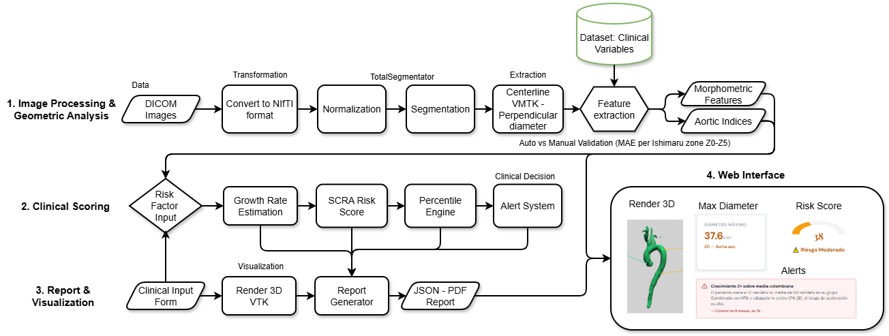

## Results at a glance

| | |
|---|---|
| Cohort | **43 CTA studies** from 30 patients, single centre |
| Diameter error vs. radiologist | **MAE 2.48 mm** (95% CI 1.70–3.50), 7.5% of the diameter |
| Correlation | **Pearson r = 0.957** (0.927–0.979) |
| Bias | −0.46 mm (limits of agreement −7.66 to +6.74 mm) |
| Differences ≥ 5 mm | 17.2% of pairs (11.8% without one atypical case), vs. 11–14% between radiologists |
| Aneurysm detection, 55 mm rule | sensitivity 33.3%, accuracy 77.8% |
| Aneurysm detection, **45 mm alert** | **sensitivity 100%, specificity 100%** (n = 9, preliminary) |
| Risk score (SCRA) as a classifier | 4 TP, 7 TN, 0 FP, 0 FN (n = 11, preliminary) |

Validation used 58 zone measurements from 9 patients against the radiologist's manual double-oblique measurements, with a patient-level bootstrap (10,000 replicates).

**Main finding.** The AHA/ACC 55 mm surgical threshold missed two of three aneurysms in this cohort, measured at 47.05 and 50.82 mm. A 45 mm alert, calibrated for the smaller body size of Colombian patients (mean BSA 1.81 m²), caught all of them. The sample is small, so this needs confirmation in larger cohorts.

## How it works

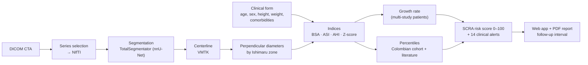

| Stage | What it does |
|---|---|
| **Segmentation** | TotalSegmentator (nnU-Net) extracts the aorta and supra-aortic branches from the CTA in original HU |
| **Centerline** | VMTK computes the minimal path through the vessel (Voronoi-based) and anatomical landmarks |
| **Diameters** | For each point a plane perpendicular to the centerline is sampled (80 mm² grid at 0.5 mm), replicating the clinical double-oblique, inner-to-inner method. Axial slices would overestimate diameters in tortuous aortas |
| **Zones** | Root, Z0 ascending, Z1–Z2 arch, Z3–Z5 descending thoracic (Ishimaru) |
| **Indices** | BSA (Mosteller), Aortic Size Index, Aortic Height Index, area/height ratio, Z-score |
| **Risk** | SCRA, an explicit and auditable score (0–100) from diameter, indices, growth rate, age and clinical history. Not a black box: every point is traceable for the physician |
| **Percentiles** | Two systems: the internal Colombian cohort (grows with each patient) and published references |

  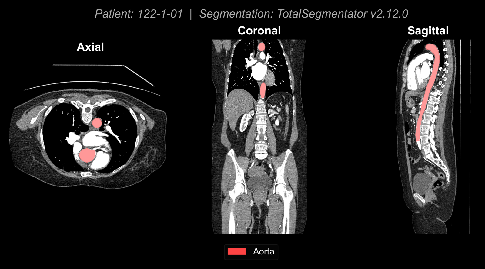
  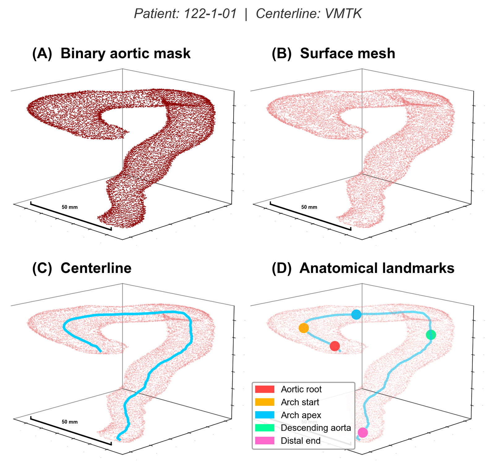 
  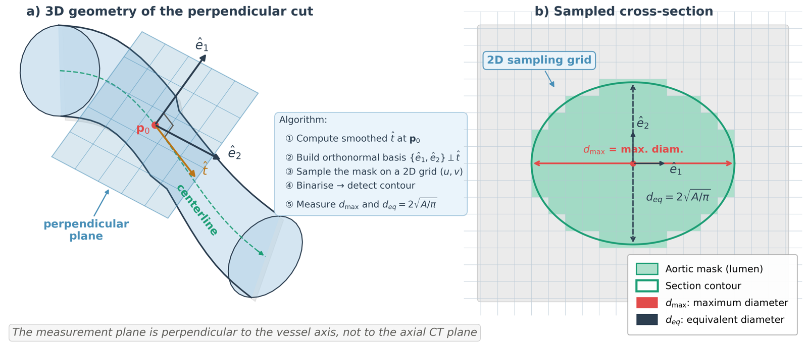

## Validation

  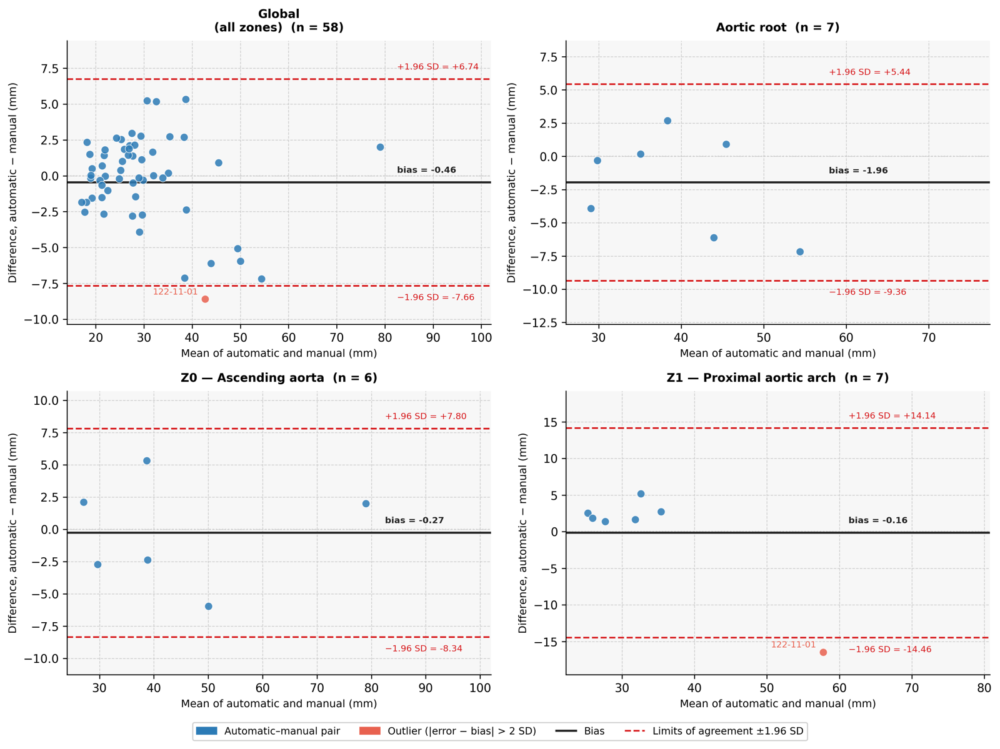
  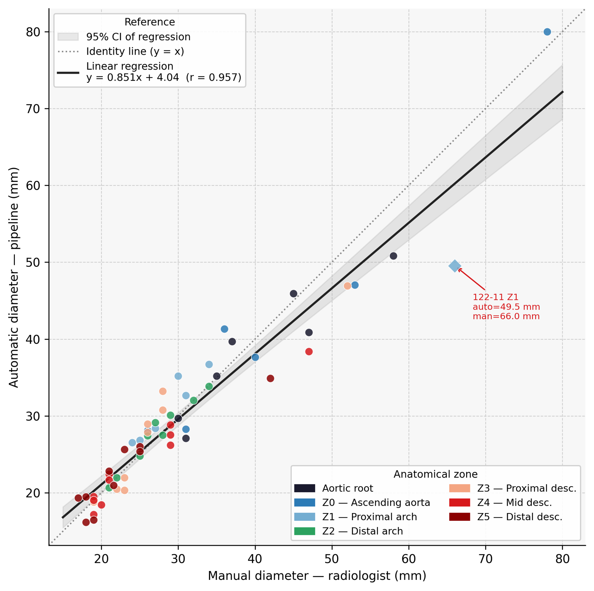

| Zone | n | Bias (mm) | MAE (mm) | MAE % | r |
|---|---|---|---|---|---|
| Root | 7 | −1.96 | 3.04 | 7.0 | 0.932 |
| Z0 ascending | 6 | −0.27 | 3.41 | 8.6 | 0.977 |
| Z1 proximal arch | 7 | −0.16 | 4.54 | 11.2 | 0.955 |
| Z2 distal arch | 9 | +0.39 | 0.66 | 2.4 | 0.977 |
| Z3 | 9 | +0.27 | 2.59 | 9.0 | 0.943 |
| Z4 | 10 | −1.38 | 1.90 | 6.4 | 0.975 |
| Z5 | 10 | −0.25 | 2.18 | 9.1 | 0.927 |
| **Global** | **58** | **−0.46** | **2.48** | **7.5** | **0.957** |

Z1 carries the largest error because of one atypical 66 mm aneurysm that the method underestimated.

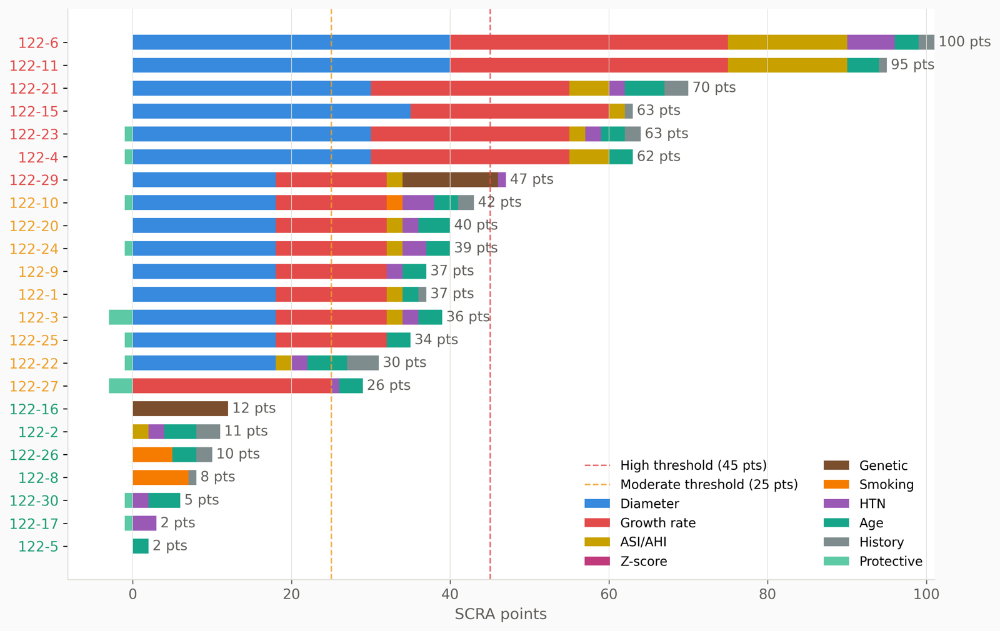

## Web application

A computer and tablet-friendly app for the physician: log in, upload the CT, fill in the clinical form, and get the report.

  
  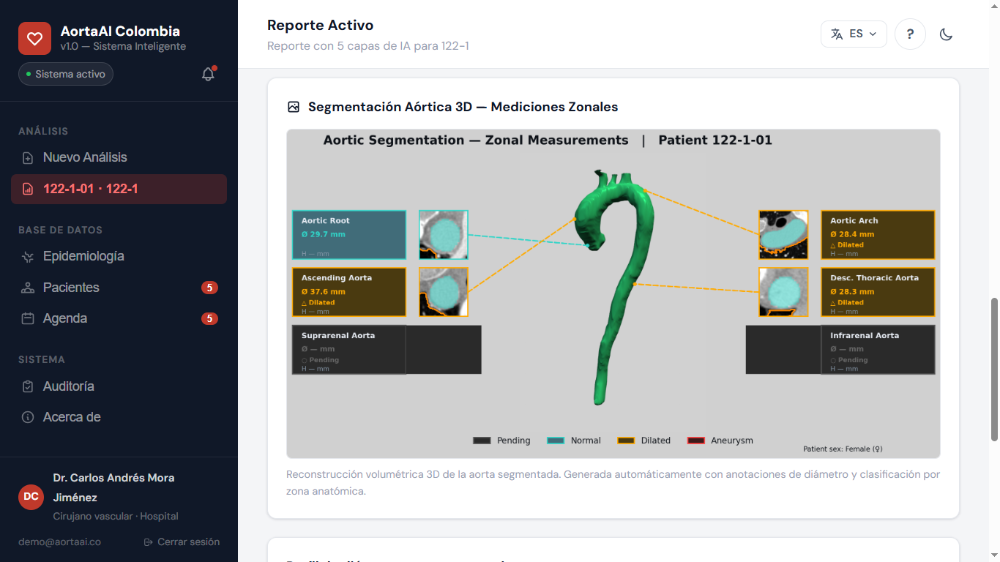 
  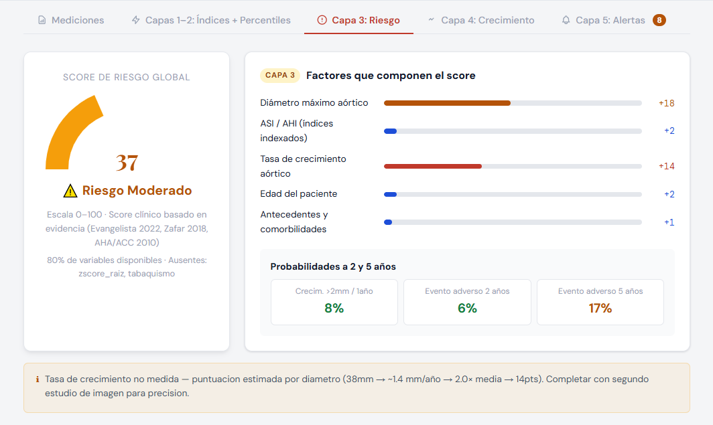
  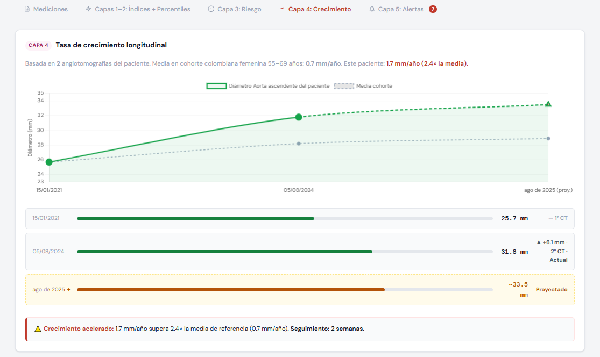

More screens: login, zone diameters, epidemiology dashboard

  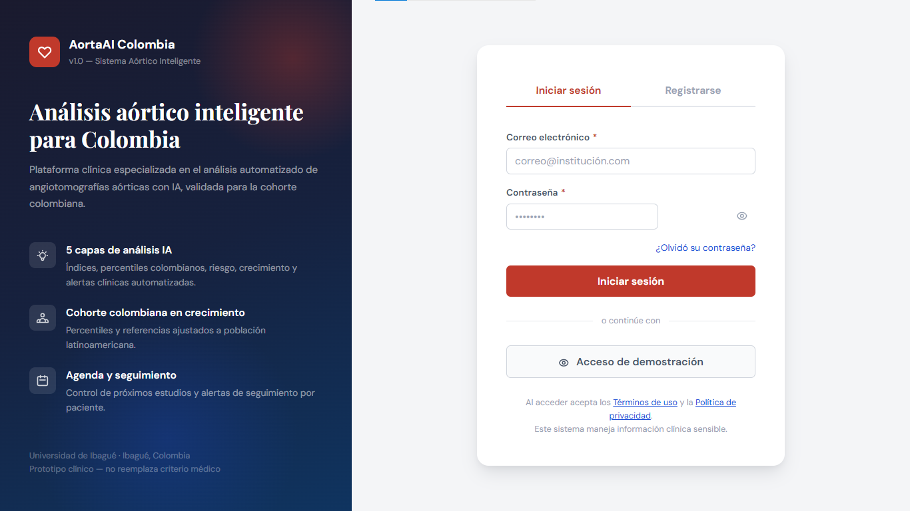
  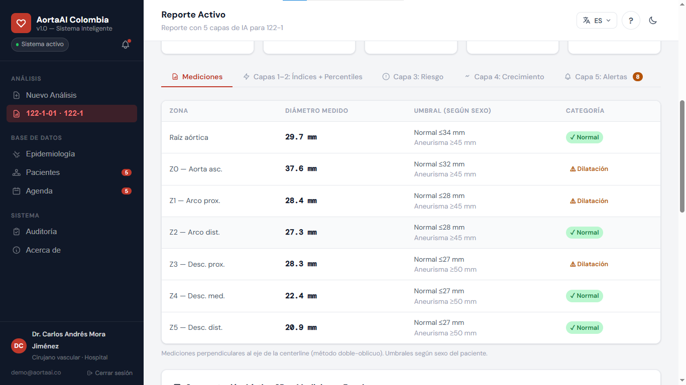 
  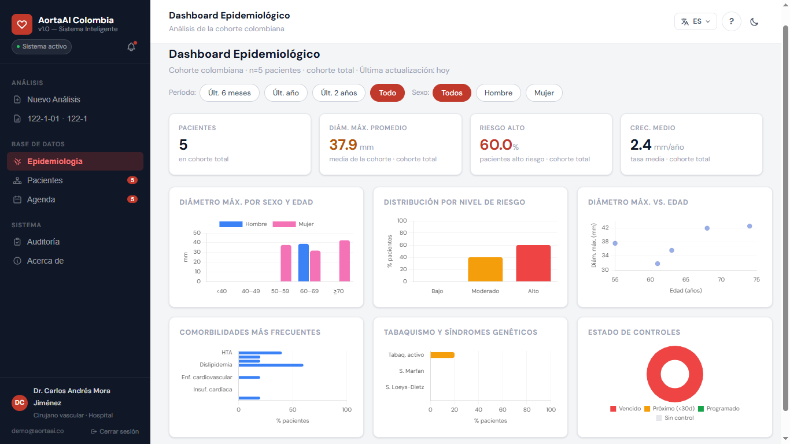

The screens show anonymised demo records.

## Stack

| Area | Tools |
|---|---|
| Imaging | SimpleITK, nibabel, pydicom, scikit-image |
| Segmentation | TotalSegmentator 2.12 (nnU-Net) |
| Geometry | VMTK 1.5, VTK, ITK |
| Analysis | NumPy, SciPy, pandas, scikit-learn (Bland–Altman, bootstrap CIs) |
| Backend | Python 3.10, FastAPI, Uvicorn, Pydantic, REST |
| Frontend | HTML5, CSS3, vanilla JavaScript (no build step, for hospital environments) |
| Reporting | 3D rendering + PDF report (ReportLab) |
| Compute | Ubuntu 24.04 workstation, NVIDIA Quadro RTX 5000 (CUDA 12) for segmentation |

## Limitations

- 30 patients from one centre, and no public Colombian CTA dataset to compare against.
- The 45 mm threshold is a conservative calibration that still needs validation in larger cohorts.
- The root is not measured at the sinus of Valsalva plane, so root Z-scores are not reported.
- One study was rejected for image quality.

**Research use only. Not a certified medical device.** Clinical decisions must be made by a qualified physician.

## Authors

- **Walter Andrés Cárdenas Barrios**, Universidad de Ibagué, Semillero Lún
- **Manuel Guillermo Forero**, Universidad de Ibagué (thesis advisor)
- **Neslihan Sezen**, Koblenz University of Applied Sciences, Germany

Clinical data: Los Cobos Medical Center, Bogotá. Studies were anonymised by the centre before analysis, in line with Colombian Resolution 8430/1993.

## Rights

© 2026 Walter Andrés Cárdenas Barrios. All rights reserved. The images and text in this repository may be shared with attribution. The source code is not published.
